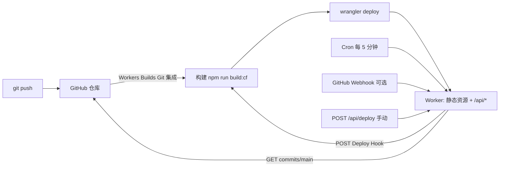

# Spark's Blog：Cloudflare Workers 自动部署 + GitHub 更新监控

> 本文是一份可以直接照做的部署手册，包含完整可复制的配置与 Worker 代码。
>
> - 目标：把 Astro 静态博客部署到 Cloudflare Workers，并由 Worker 监视 GitHub 仓库；检测到新提交就自动触发重新构建与发布。
> - 适用仓库：`PILIHU2022/Blog`（Astro 7，构建产物 `dist/`）。
> - 验证环境：Node.js 22、`wrangler` 4.151.1、Cloudflare Workers Builds（2026-10）。
> - Worker 名称：`blog-astro`（旧的 Hugo Worker 是 `spark-blog`，两者互不覆盖）。
> - 当前站点仍由 Vercel 提供服务；第 10 节说明如何切换域名到 Workers。

## 0. 方案总览

### 0.1 为什么不是“在 Worker 里执行 astro build”

Cloudflare Worker 运行在 V8 isolate 中，适合处理 HTTP、定时任务和轻量逻辑，但它不是一个完整的构建机：

- `astro build` 需要 npm 依赖树、Node 构建链，以及 `sharp`、`pagefind` 等平台相关的原生二进制；
- 构建过程需要可写的文件系统、较长的 CPU 时间和较大的内存，Worker 运行时的限制不适合做这件事；
- 即使通过 Node.js 兼容层勉强运行，也无法可靠地执行 `npm ci` 和原生模块安装。

所以正确的分工是：

| 角色             | 由谁承担                      | 职责                                                                    |
| ---------------- | ----------------------------- | ----------------------------------------------------------------------- |
| 构建、发布       | **Cloudflare Workers Builds** | 检出 GitHub 代码，执行 `npm run build:cf`，再执行 `wrangler deploy`     |
| 站点与监控       | **同一个 Worker**             | 提供 `dist/` 静态资源，并提供 `/api/*` 监控接口                         |
| 定时检查         | **Cron Trigger**              | 每 5 分钟读取 GitHub 分支 HEAD，与线上构建的 commit 对比                |
| 触发构建         | **Deploy Hook**               | Worker 发现新提交后，向 Deploy Hook 发一个 POST，让 Workers Builds 重建 |
| 去重状态         | **Workers KV**                | 记录最近一次触发，避免构建期间反复触发                                  |
| 即时触发（可选） | **GitHub Webhook**            | push 后立刻通知 Worker，缩短等待时间                                    |

### 0.2 数据流



一句话版本：

1. 接入 Workers Builds 后，每次 push 都会自动构建一次；
2. cron 作为兜底，对比 GitHub HEAD 与线上 `_deploy.json` 中的 SHA；
3. 两者不一致时，Worker 调用 Deploy Hook 触发一次新的构建；
4. 新版本上线后，`_deploy.json` 更新为新的 SHA，下一轮 cron 自动变为 no-op。

> **为什么要加 cron，既然 Git 集成已经会自动构建？**
> Git 集成的 Webhook 可能因为权限、仓库迁移、Cloudflare 侧事件丢失等原因没有触发；cron 是一个幂等的“对账”机制。它也会在你手动触发、构建失败重试、或需要定期重建时提供统一的入口。

### 0.3 仓库里要新增/修改什么

| 路径                           | 动作         | 作用                                                             |
| ------------------------------ | ------------ | ---------------------------------------------------------------- |
| `wrangler.jsonc`               | 新增         | Worker 名称、入口、静态资源、Cron、KV 绑定                       |
| `worker/index.ts`              | 新增         | 监控与触发逻辑、`/api/*` 接口                                    |
| `worker/tsconfig.json`         | 新增         | 单独对 Worker 代码做类型检查                                     |
| `scripts/write-build-info.mjs` | 新增         | 构建后写入 `dist/_deploy.json`                                   |
| `package.json`                 | 修改         | 增加 `build:cf`、`deploy`、`check:worker` 和两个 devDependencies |
| `tsconfig.json`                | 修改         | 让 Astro 的 `astro check` 忽略 Worker 目录                       |
| `.gitignore`                   | 修改         | 忽略 `.wrangler/` 和 `.dev.vars`                                 |
| `public/_redirects`            | 新增         | 把 Vercel 的旧链接重定向迁移到 Workers                           |
| `public/_headers`              | 新增（可选） | 静态资源缓存头                                                   |

## 1. 前置条件

- 一个 Cloudflare 账号，已开通 Workers & Pages；
- 如果要绑定 `blog.sparkzh.top`，该域名所在的 DNS 区域需要接入 Cloudflare（否则先用 `*.workers.dev` 验证）；
- GitHub 仓库 `PILIHU2022/Blog` 的管理员权限（可选配置 Webhook 时需要）；
- 本地 Node.js `>= 22.12.0`（仓库的 `.nvmrc` 是 22）；
- 可以执行 `npx wrangler login` 的浏览器环境，或一个具备 Workers 权限的 `CLOUDFLARE_API_TOKEN`；
- 一个 GitHub fine-grained PAT（公开仓库理论上可以匿名访问，但强烈建议配置，见第 6 节）。

先确认本地能构建：

```bash
node -v          # >= 22.12.0
npm ci
npm run build
ls dist/404.html dist/index.html
```

## 2. 仓库改造

以下文件都放在仓库根目录。先全部创建/修改，再执行第 3 节的首次部署。

### 2.1 `wrangler.jsonc`

```jsonc
{
  "$schema": "./node_modules/wrangler/config-schema.json",

  // Worker 名称。旧的 Hugo 版本 Worker 叫 spark-blog，这里用 blog-astro 避免覆盖。
  "name": "blog-astro",

  // Worker 入口：除了静态资源，还提供 /api/* 监控接口。
  "main": "./worker/index.ts",

  // 建议随部署日期更新。
  "compatibility_date": "2026-10-17",

  // 保留 workers.dev 地址；不生成版本预览 URL（博客不需要）。
  "workers_dev": true,
  "preview_urls": false,

  "assets": {
    // Astro 的构建产物
    "directory": "./dist",
    "binding": "ASSETS",
    // 未命中的路径返回 dist/404.html
    "not_found_handling": "404-page",
    // /api/* 必须进入 Worker；其余请求由静态资源层直接返回
    "run_worker_first": ["/api/*"],
  },

  "triggers": {
    // 每 5 分钟检查一次 GitHub（UTC）。修改后需重新 deploy 才生效。
    "crons": ["*/5 * * * *"],
  },

  "observability": {
    "enabled": true,
  },

  "vars": {
    "GITHUB_REPO": "PILIHU2022/Blog",
    "GITHUB_BRANCH": "main",
    // 触发后 15 分钟内不再重复触发同一个 commit
    "DEPLOY_COOLDOWN_SECONDS": "900",
  },

  "kv_namespaces": [
    {
      "binding": "DEPLOY_STATE",
      // 由 `npx wrangler kv namespace create DEPLOY_STATE` 创建
      "id": "00000000000000000000000000000000",
    },
  ],
}
```

要点：

- `name` 必须与 Cloudflare 上的 Worker 名称一致。本文使用 `blog-astro`；旧的 Hugo 部署副本叫 `spark-blog`（见 `.tmp-blogworkers/`），因此不会互相覆盖。
- `assets.directory` 指向 Astro 的 `dist/`；`binding: "ASSETS"` 让 Worker 能读取 `/_deploy.json`。
- `run_worker_first: ["/api/*"]` 保证 API 请求一定进入 Worker；其他请求由静态资源层直接返回，不消耗 Worker 调用。
- `not_found_handling: "404-page"` 使用 `dist/404.html`。
- Cron 使用 UTC；`*/5 * * * *` 表示每 5 分钟。修改 Cron 后需要重新 `wrangler deploy` 才生效，且 Cloudflare 侧同步可能延迟最多约 15 分钟。
- `kv_namespaces[0].id` 先保留占位符，第 3 节创建 KV 后替换。
- 自定义域名不写在这里，避免首次部署因 DNS 未就绪而失败；第 10 节在控制台绑定。

### 2.2 `worker/index.ts`

```ts
/**
 * Spark's Blog —— Cloudflare Worker
 *
 * 职责：
 *   1. 把 Astro 构建出的 dist/ 作为静态资源提供（ASSETS 绑定）；
 *   2. 每 5 分钟对比 GitHub 分支 HEAD 与当前线上构建的 commit SHA；
 *   3. 发现新提交时调用 Workers Builds 的 Deploy Hook，触发重新构建与部署；
 *   4. 提供可选的 GitHub Webhook（即时触发）与手动触发接口。
 *
 * 说明：Worker 运行时无法执行 `astro build`（需要 npm、Node 构建链、
 * sharp/pagefind 等本地二进制），所以“构建”交给 Cloudflare Workers Builds，
 * 本 Worker 只负责监控和触发。
 */

interface Env {
  /** 静态资源绑定：wrangler.jsonc 中的 assets.binding */
  ASSETS: Fetcher;
  /** 记录上一次触发状态，避免构建期间重复触发 */
  DEPLOY_STATE: KVNamespace;

  /** GitHub 仓库，格式 owner/repo */
  GITHUB_REPO: string;
  /** 要监控的分支 */
  GITHUB_BRANCH: string;
  /** Workers Builds Deploy Hook 的完整 URL（secret） */
  DEPLOY_HOOK_URL: string;
  /** GitHub PAT，公开仓库可省略（secret） */
  GITHUB_TOKEN?: string;
  /** GitHub Webhook secret，配置 Webhook 时必填（secret） */
  WEBHOOK_SECRET?: string;
  /** 手动触发接口的 Bearer Token（secret） */
  MANUAL_DEPLOY_TOKEN?: string;
  /** 触发冷却时间（秒），默认 900 */
  DEPLOY_COOLDOWN_SECONDS?: string;
}

interface BuildInfo {
  sha: string;
  shortSha?: string;
  branch?: string;
  builtAt?: string;
  buildUuid?: string | null;
  source?: string;
}

interface HeadCommit {
  sha: string;
  message: string;
  date: string | null;
  url: string;
}

interface DeployState {
  targetSha: string;
  triggeredAt: number;
  attempts: number;
  buildUuid?: string | null;
  reason: string;
}

interface PushPayload {
  ref?: string;
  after?: string;
  deleted?: boolean;
}

type ReconcileResult =
  | { status: 'up-to-date'; headSha: string; deployedSha: string }
  | { status: 'triggered'; headSha: string; buildUuid: string | null; reason: string }
  | { status: 'skipped'; headSha: string; reason: 'cooldown'; retryAfterSeconds: number }
  | { status: 'skipped'; headSha: string; reason: 'max-attempts'; attempts: number }
  | { status: 'error'; message: string };

const STATE_KEY = 'deploy:last-trigger';
const DEFAULT_COOLDOWN_SECONDS = 900;
// 同一个 commit 最多自动重试 6 次（约 1.5 小时）后停止，避免构建持续失败时
// 无限消耗 Workers Builds 的构建额度。新提交或手动 force 会重新计数。
const MAX_DEPLOY_ATTEMPTS = 6;
const STATE_TTL_SECONDS = 7 * 24 * 60 * 60;
const GITHUB_API_VERSION = '2022-11-28';
const USER_AGENT = 'blog-astro-deploy-worker';

/* -------------------------------------------------------------------------- */
/* 通用工具                                                                    */
/* -------------------------------------------------------------------------- */

function json(data: unknown, status = 200, extraHeaders?: HeadersInit): Response {
  const headers = new Headers(extraHeaders);
  headers.set('content-type', 'application/json; charset=utf-8');
  headers.set('cache-control', 'no-store');
  return new Response(`${JSON.stringify(data, null, 2)}\n`, { status, headers });
}

function methodNotAllowed(allow: string): Response {
  return json({ error: 'method_not_allowed' }, 405, { allow });
}

function errorMessage(error: unknown): string {
  return error instanceof Error ? error.message : String(error);
}

function cooldownMs(env: Env): number {
  const seconds = Number(env.DEPLOY_COOLDOWN_SECONDS);
  if (!Number.isFinite(seconds) || seconds <= 0) return DEFAULT_COOLDOWN_SECONDS * 1000;
  return Math.min(Math.max(seconds, 60), 86_400) * 1000;
}

function timingSafeEqual(a: string, b: string): boolean {
  const left = new TextEncoder().encode(a);
  const right = new TextEncoder().encode(b);
  if (left.length !== right.length) return false;
  let diff = 0;
  for (let i = 0; i < left.length; i += 1) diff |= left[i] ^ right[i];
  return diff === 0;
}

function isAuthorized(request: Request, expected: string): boolean {
  const header = request.headers.get('authorization') ?? '';
  const prefix = 'Bearer ';
  return header.startsWith(prefix) && timingSafeEqual(header.slice(prefix.length), expected);
}

function hexToBytes(hex: string): Uint8Array | null {
  if (hex.length % 2 !== 0 || !/^[0-9a-f]+$/i.test(hex)) return null;
  const bytes = new Uint8Array(hex.length / 2);
  for (let i = 0; i < bytes.length; i += 1) {
    bytes[i] = Number.parseInt(hex.slice(i * 2, i * 2 + 2), 16);
  }
  return bytes;
}

/* -------------------------------------------------------------------------- */
/* GitHub                                                                      */
/* -------------------------------------------------------------------------- */

async function fetchHead(env: Env): Promise<HeadCommit> {
  const [owner, repo, ...rest] = env.GITHUB_REPO.split('/');
  if (!owner || !repo || rest.length > 0) {
    throw new Error(`GITHUB_REPO 格式应为 owner/repo，当前为 "${env.GITHUB_REPO}"`);
  }

  const endpoint = `https://api.github.com/repos/${owner}/${repo}/commits/${encodeURIComponent(env.GITHUB_BRANCH)}`;
  const headers = new Headers({
    accept: 'application/vnd.github+json',
    'x-github-api-version': GITHUB_API_VERSION,
    'user-agent': USER_AGENT,
  });
  if (env.GITHUB_TOKEN) headers.set('authorization', `Bearer ${env.GITHUB_TOKEN}`);

  const response = await fetch(endpoint, { headers });
  if (!response.ok) {
    const body = (await response.text()).slice(0, 300);
    throw new Error(`GitHub API ${response.status} ${response.statusText}: ${body}`);
  }

  const data = (await response.json()) as {
    sha: string;
    html_url: string;
    commit: {
      message: string;
      author?: { date?: string };
      committer?: { date?: string };
    };
  };

  return {
    sha: data.sha,
    message: data.commit.message.split('\n')[0] ?? '',
    date: data.commit.committer?.date ?? data.commit.author?.date ?? null,
    url: data.html_url,
  };
}

async function verifyGitHubSignature(
  secret: string,
  body: string,
  signature: string,
): Promise<boolean> {
  if (!signature.startsWith('sha256=')) return false;
  const signatureBytes = hexToBytes(signature.slice('sha256='.length));
  if (!signatureBytes) return false;

  const key = await crypto.subtle.importKey(
    'raw',
    new TextEncoder().encode(secret),
    { name: 'HMAC', hash: 'SHA-256' },
    false,
    ['verify'],
  );
  const signatureBuffer = signatureBytes.buffer.slice(
    signatureBytes.byteOffset,
    signatureBytes.byteOffset + signatureBytes.byteLength,
  ) as ArrayBuffer;

  return crypto.subtle.verify('HMAC', key, signatureBuffer, new TextEncoder().encode(body));
}

/* -------------------------------------------------------------------------- */
/* 部署状态                                                                    */
/* -------------------------------------------------------------------------- */

async function readBuildInfo(env: Env): Promise<BuildInfo | null> {
  try {
    // ASSETS.fetch 只使用 URL 的 pathname，hostname 可以任意填写。
    const response = await env.ASSETS.fetch(new URL('/_deploy.json', 'https://assets.local'));
    if (!response.ok) return null;
    const data = (await response.json()) as BuildInfo;
    return typeof data?.sha === 'string' ? data : null;
  } catch (error) {
    console.warn(JSON.stringify({ event: 'build-info.read.error', message: errorMessage(error) }));
    return null;
  }
}

async function readState(env: Env): Promise<DeployState | null> {
  try {
    return await env.DEPLOY_STATE.get<DeployState>(STATE_KEY, 'json');
  } catch (error) {
    console.warn(JSON.stringify({ event: 'state.read.error', message: errorMessage(error) }));
    return null;
  }
}

async function writeState(env: Env, state: DeployState): Promise<void> {
  try {
    await env.DEPLOY_STATE.put(STATE_KEY, JSON.stringify(state), {
      expirationTtl: STATE_TTL_SECONDS,
    });
  } catch (error) {
    // 状态写失败不应影响已经发出的部署请求；下次 cron 可能重复触发一次。
    console.warn(JSON.stringify({ event: 'state.write.error', message: errorMessage(error) }));
  }
}

/* -------------------------------------------------------------------------- */
/* 触发部署                                                                    */
/* -------------------------------------------------------------------------- */

async function triggerDeploy(
  env: Env,
  reason: string,
  head: HeadCommit,
  attempts: number,
): Promise<string | null> {
  if (!env.DEPLOY_HOOK_URL) throw new Error('缺少 DEPLOY_HOOK_URL secret');

  const response = await fetch(env.DEPLOY_HOOK_URL, {
    method: 'POST',
    headers: { 'user-agent': USER_AGENT },
  });

  const text = await response.text();
  let payload: unknown = null;
  try {
    payload = JSON.parse(text);
  } catch {
    // 下面统一按失败处理：Deploy Hook 正常会返回 JSON。
  }

  const failed =
    !response.ok ||
    payload === null ||
    typeof payload !== 'object' ||
    ('success' in payload && payload.success === false);

  if (failed) {
    throw new Error(`Deploy Hook 调用失败（HTTP ${response.status}）：${text.slice(0, 300)}`);
  }

  const buildUuid =
    payload && typeof payload === 'object' && 'result' in payload
      ? ((payload.result as { build_uuid?: string } | null)?.build_uuid ?? null)
      : null;

  await writeState(env, {
    targetSha: head.sha,
    triggeredAt: Date.now(),
    attempts,
    buildUuid,
    reason,
  });

  return buildUuid;
}

async function reconcile(
  env: Env,
  options: { reason: string; force?: boolean },
): Promise<ReconcileResult> {
  let head: HeadCommit;
  try {
    head = await fetchHead(env);
  } catch (error) {
    return { status: 'error', message: errorMessage(error) };
  }

  const deployed = await readBuildInfo(env);
  if (!options.force && deployed?.sha === head.sha) {
    return { status: 'up-to-date', headSha: head.sha, deployedSha: deployed.sha };
  }

  let attempts = 0;
  if (!options.force) {
    const state = await readState(env);
    if (state && state.targetSha === head.sha) {
      attempts = Math.max(state.attempts ?? 1, 1);
      if (attempts >= MAX_DEPLOY_ATTEMPTS) {
        return { status: 'skipped', headSha: head.sha, reason: 'max-attempts', attempts };
      }
      const wait = cooldownMs(env);
      const elapsed = Date.now() - state.triggeredAt;
      if (elapsed >= 0 && elapsed < wait) {
        return {
          status: 'skipped',
          headSha: head.sha,
          reason: 'cooldown',
          retryAfterSeconds: Math.ceil((wait - elapsed) / 1000),
        };
      }
    }
  }

  try {
    const buildUuid = await triggerDeploy(
      env,
      options.reason,
      head,
      options.force ? 1 : attempts + 1,
    );
    return { status: 'triggered', headSha: head.sha, buildUuid, reason: options.reason };
  } catch (error) {
    return { status: 'error', message: errorMessage(error) };
  }
}

async function runReconcile(env: Env, reason: string, force = false): Promise<ReconcileResult> {
  const result = await reconcile(env, { reason, force });
  const log = { event: 'reconcile', reason, ...result };
  if (result.status === 'error') console.error(JSON.stringify(log));
  else console.log(JSON.stringify(log));
  return result;
}

/* -------------------------------------------------------------------------- */
/* 路由                                                                        */
/* -------------------------------------------------------------------------- */

async function handleStatus(env: Env): Promise<Response> {
  const [deployed, state] = await Promise.all([readBuildInfo(env), readState(env)]);
  return json({
    ok: true,
    deployed,
    lastTrigger: state,
    config: {
      repo: env.GITHUB_REPO,
      branch: env.GITHUB_BRANCH,
      cooldownSeconds: Math.round(cooldownMs(env) / 1000),
      githubTokenConfigured: Boolean(env.GITHUB_TOKEN),
      deployHookConfigured: Boolean(env.DEPLOY_HOOK_URL),
      webhookConfigured: Boolean(env.WEBHOOK_SECRET),
      manualDeployConfigured: Boolean(env.MANUAL_DEPLOY_TOKEN),
    },
  });
}

async function handleManualDeploy(request: Request, env: Env, url: URL): Promise<Response> {
  if (!env.MANUAL_DEPLOY_TOKEN) {
    return json({ error: 'manual_deploy_disabled' }, 503);
  }
  if (!isAuthorized(request, env.MANUAL_DEPLOY_TOKEN)) {
    return json({ error: 'unauthorized' }, 401);
  }

  const force = url.searchParams.get('force') === '1';
  const result = await runReconcile(env, force ? 'manual-force' : 'manual', force);
  if (result.status === 'error') return json(result, 502);
  return json(result, result.status === 'triggered' ? 202 : 200);
}

async function handleWebhook(request: Request, env: Env, ctx: ExecutionContext): Promise<Response> {
  if (!env.WEBHOOK_SECRET) {
    return json({ error: 'webhook_disabled' }, 503);
  }

  const body = await request.text();
  const signature = request.headers.get('x-hub-signature-256');
  if (!signature || !(await verifyGitHubSignature(env.WEBHOOK_SECRET, body, signature))) {
    return json({ error: 'invalid_signature' }, 401);
  }

  const event = request.headers.get('x-github-event') ?? '';
  if (event === 'ping') return json({ ok: true, pong: true });
  if (event !== 'push') return json({ ok: true, ignored: `event:${event}` }, 202);

  let payload: PushPayload;
  try {
    payload = JSON.parse(body) as PushPayload;
  } catch {
    return json({ error: 'invalid_json' }, 400);
  }

  if (payload.deleted || payload.ref !== `refs/heads/${env.GITHUB_BRANCH}`) {
    return json({ ok: true, ignored: `ref:${payload.ref ?? 'unknown'}` }, 202);
  }
  if (!payload.after || /^0+$/.test(payload.after)) {
    return json({ ok: true, ignored: 'zero_sha' }, 202);
  }

  // 先返回 2xx，避免 GitHub 因超时重投；实际触发在后台完成。
  ctx.waitUntil(runReconcile(env, 'webhook'));
  return json({ ok: true, queued: true, push: payload.after }, 202);
}

export default {
  async fetch(request, env, ctx): Promise<Response> {
    const url = new URL(request.url);

    try {
      if (url.pathname === '/api/health') {
        if (request.method !== 'GET' && request.method !== 'HEAD')
          return methodNotAllowed('GET, HEAD');
        return json({ ok: true, now: new Date().toISOString() });
      }

      if (url.pathname === '/api/status') {
        if (request.method !== 'GET') return methodNotAllowed('GET');
        return await handleStatus(env);
      }

      if (url.pathname === '/api/deploy') {
        if (request.method !== 'POST') return methodNotAllowed('POST');
        return await handleManualDeploy(request, env, url);
      }

      if (url.pathname === '/api/github/webhook') {
        if (request.method !== 'POST') return methodNotAllowed('POST');
        return await handleWebhook(request, env, ctx);
      }

      if (url.pathname.startsWith('/api/')) {
        return json({ error: 'not_found' }, 404);
      }

      // 其余请求交给静态资源层（含 not_found_handling: 404-page）。
      return await env.ASSETS.fetch(request);
    } catch (error) {
      console.error(
        JSON.stringify({
          event: 'request.error',
          path: url.pathname,
          message: errorMessage(error),
        }),
      );
      return json({ error: 'internal_error' }, 500);
    }
  },

  async scheduled(_controller, env, ctx): Promise<void> {
    ctx.waitUntil(runReconcile(env, 'cron'));
  },
} satisfies ExportedHandler<Env>;
```

它暴露的接口：

| 方法与路径                 | 认证                                          | 说明                                                         |
| -------------------------- | --------------------------------------------- | ------------------------------------------------------------ |
| `GET /api/health`          | 无                                            | 健康检查，返回 `{ ok: true }`                                |
| `GET /api/status`          | 无                                            | 当前线上构建信息、最近触发状态、配置是否齐全（不返回密钥值） |
| `POST /api/deploy`         | `Authorization: Bearer <MANUAL_DEPLOY_TOKEN>` | 手动触发一次检查与部署；`?force=1` 跳过冷却和“已是最新”判断  |
| `POST /api/github/webhook` | GitHub HMAC 签名                              | 可选的 GitHub push Webhook                                   |
| 其他 `/api/*`              | 无                                            | 返回 JSON 404                                                |
| 其他路径                   | 无                                            | 交给 `ASSETS` 静态资源层                                     |

监控逻辑的核心是 `reconcile()`：

1. `fetchHead()` 请求 `GET https://api.github.com/repos/{owner}/{repo}/commits/{branch}`；
2. `readBuildInfo()` 通过 `ASSETS.fetch('/_deploy.json')` 读取当前线上版本对应的 SHA；
3. SHA 相同 → `up-to-date`，不做任何事；
4. SHA 不同 → 查 KV 中的 `deploy:last-trigger`：
   - 同一个目标 SHA 已触发过，且还在冷却期 → `skipped`；
   - 同一个目标 SHA 已自动重试 6 次 → `skipped (max-attempts)`，避免无限消耗构建额度；
5. 否则 `POST DEPLOY_HOOK_URL`，成功后在 KV 记录 `{ targetSha, triggeredAt, attempts, buildUuid }`。

几个实现细节：

- Deploy Hook 成功但构建失败时，线上 SHA 仍是旧的；冷却期过后 cron 会自动重试，最多 6 次。新提交会重置计数，手动 `?force=1` 也会重置。
- KV 是最终一致的，刚写入的状态在极短时间内可能读不到；Deploy Hook 自身对“排队中/初始化中”的重复请求有幂等处理，因此最坏情况只是多一次构建。
- Worker 没有引入任何 npm 运行时依赖，`wrangler deploy` 直接用 esbuild 打包，体积很小。
- Webhook 使用 `X-Hub-Signature-256` 做 HMAC-SHA256 校验；未配置 `WEBHOOK_SECRET` 时该接口返回 503。
- 手动接口使用常量时间比较，避免明显的时序侧信道。

### 2.3 `worker/tsconfig.json`

```json
{
  "compilerOptions": {
    "target": "ES2022",
    "module": "ESNext",
    "moduleResolution": "Bundler",
    "lib": ["ES2022"],
    "types": ["@cloudflare/workers-types"],
    "strict": true,
    "noEmit": true,
    "isolatedModules": true,
    "skipLibCheck": true
  },
  "include": ["index.ts"]
}
```

Worker 与 Astro 的类型环境不同（Workers 全局类型 vs DOM），所以单独一个 `tsconfig`，并在根 `tsconfig.json` 中把 `worker` 排除，避免 `astro check` 把两套全局类型混在一起。

### 2.4 `scripts/write-build-info.mjs`

```js
#!/usr/bin/env node
/**
 * 生成 dist/_deploy.json，记录本次构建对应的 commit。
 *
 * Workers Builds 会在构建阶段注入 WORKERS_CI_COMMIT_SHA / WORKERS_CI_BRANCH /
 * WORKERS_CI_BUILD_UUID；本地构建则回退到 git 命令。Worker 在 cron 中读取这个
 * 文件，与 GitHub 分支 HEAD 对比，从而判断线上是否落后。
 */
import { execFileSync } from 'node:child_process';
import { mkdirSync, writeFileSync } from 'node:fs';
import { resolve } from 'node:path';

function git(args) {
  try {
    return execFileSync('git', args, { encoding: 'utf8' }).trim();
  } catch {
    return '';
  }
}

const sha =
  process.env.WORKERS_CI_COMMIT_SHA || process.env.GITHUB_SHA || git(['rev-parse', 'HEAD']);
const branch =
  process.env.WORKERS_CI_BRANCH ||
  process.env.GITHUB_REF_NAME ||
  git(['rev-parse', '--abbrev-ref', 'HEAD']) ||
  'unknown';

if (!/^[0-9a-f]{7,64}$/i.test(sha)) {
  console.error(
    `[build-info] 无法确定有效的 commit SHA（得到 "${sha}"）：请设置 WORKERS_CI_COMMIT_SHA 或在 git 仓库中构建。`,
  );
  process.exit(1);
}

const info = {
  sha,
  shortSha: sha.slice(0, 7),
  branch,
  builtAt: new Date().toISOString(),
  buildUuid: process.env.WORKERS_CI_BUILD_UUID ?? null,
  source: process.env.WORKERS_CI
    ? 'workers-builds'
    : process.env.GITHUB_ACTIONS
      ? 'github-actions'
      : 'local',
};

const outputDir = resolve(process.cwd(), 'dist');
mkdirSync(outputDir, { recursive: true });
writeFileSync(resolve(outputDir, '_deploy.json'), `${JSON.stringify(info, null, 2)}\n`, 'utf8');

console.log(`[build-info] ${info.branch}@${info.shortSha} (${info.source}) -> dist/_deploy.json`);
```

Workers Builds 在构建阶段会自动注入以下变量：

| 变量                    | 值                    |
| ----------------------- | --------------------- |
| `WORKERS_CI`            | `1`                   |
| `WORKERS_CI_COMMIT_SHA` | 当前构建的 commit SHA |
| `WORKERS_CI_BRANCH`     | 触发构建的分支        |
| `WORKERS_CI_BUILD_UUID` | 本次构建的 UUID       |

脚本把它们写进 `dist/_deploy.json`，例如：

```json
{
  "sha": "1a97d83...",
  "shortSha": "1a97d83",
  "branch": "main",
  "builtAt": "2026-10-17T04:00:00.000Z",
  "buildUuid": "a1b2c3d4-...",
  "source": "workers-builds"
}
```

本地构建会回退到 `git rev-parse HEAD`；如果拿不到合法 SHA，脚本会失败，避免部署一个无法对账的版本。`_deploy.json` 会作为静态资源一起上传，Worker 在 cron 中读取它。

### 2.5 `package.json`

在现有脚本中加入三项，并在 `devDependencies` 中加入 `wrangler` 与 Workers 类型：

```diff
   "scripts": {
     "dev": "astro dev",
     "build": "astro build",
     "postbuild": "pagefind --site dist",
+    "build:cf": "npm run build && node scripts/write-build-info.mjs",
+    "deploy": "wrangler deploy",
+    "check:worker": "tsc -p worker/tsconfig.json",
     "preview": "astro preview",
     "check": "astro check",
     "format": "prettier --write .",
     "format:check": "prettier --check .",
     "astro": "astro",
     "clean": "rm -rf dist .astro"
   },
   "devDependencies": {
     "@astrojs/check": "^0.9.10",
+    "@cloudflare/workers-types": "^5.20261016.1",
     "pagefind": "^1.5.2",
     "prettier": "^3.9.9",
     "prettier-plugin-astro": "^0.14.1",
     "satori": "^0.33.5",
     "sharp": "^0.35.3",
-    "typescript": "^6.0.3"
+    "typescript": "^6.0.3",
+    "wrangler": "^4.151.1"
   }
```

说明：

- `build:cf` 里的 `npm run build` 会自动触发 `postbuild`（Pagefind 索引），随后才写 `_deploy.json`；
- Vercel 仍然使用原来的 `npm run build`，不受影响；
- `wrangler` 放在 devDependencies，Workers Builds 会使用这个版本，避免 `npx` 每次拉最新版造成不可复现；
- 版本号以当时 `npm view wrangler version` / `npm view @cloudflare/workers-types version` 为准，本文验证的是 `4.151.1` / `5.20261016.1`。

如果不想手动改版本，也可以执行：

```bash
npm install -D wrangler @cloudflare/workers-types
```

> 手动改完 `package.json` 后务必执行一次 `npm install` 更新 `package-lock.json`，并把两个文件一起提交。Workers Builds 默认执行 `npm ci`，lockfile 与 `package.json` 不一致会直接让构建失败。

### 2.6 根 `tsconfig.json`

```json
{
  "extends": "astro/tsconfigs/strict",
  "include": [".astro/types.d.ts", "**/*"],
  "exclude": ["dist", "worker"]
}
```

只加了一个 `"worker"` 到 `exclude`，让 `astro check` 不处理 Worker 文件；Worker 由 `npm run check:worker` 单独检查。

### 2.7 `.gitignore`

在“环境变量与密钥”一节加入：

```gitignore
# Wrangler 本地状态与 dev secrets
/.wrangler/
.dev.vars
```

`.dev.vars` 是 `wrangler dev` 读取的本地密钥文件，绝不能提交。

### 2.8 `public/_redirects`

Astro 会把 `public/` 原样复制到 `dist/`，Cloudflare Workers 静态资源会读取根目录的 `_redirects`。把现有 `vercel.json` 里的旧 Hugo 链接迁移过来：

```txt
# 旧 Hugo / FixIt 链接 → Astro 路由
# 规则按顺序匹配，命中第一条即停止；所有静态规则放在动态规则/通配符之前。
# 文档：https://developers.cloudflare.com/workers/static-assets/redirects/

/index.xml /rss.xml 301
/posts/index.xml /rss.xml 301
/sitemap.xml /sitemap-index.xml 301

/archives /blog/ 301
/archives/ /blog/ 301
/collections /blog/ 301
/collections/ /blog/ 301
/offline / 301
/offline/ / 301
/link /about/ 301
/link/ /about/ 301

/tags /blog/ 301
/tags/ /blog/ 301
/categories /blog/ 301
/categories/ /blog/ 301

# 旧标签 / 分类名的特例
/tags/arch /blog/tags/arch-linux 301
/tags/arch/ /blog/tags/arch-linux 301
/categories/arch-linux /blog/tags/arch-linux 301
/categories/arch-linux/ /blog/tags/arch-linux 301
/categories/guide /blog/tags/guides 301
/categories/guide/ /blog/tags/guides 301
/categories/blog /blog/tags/blog 301
/categories/blog/ /blog/tags/blog 301

/authors /about/ 301
/authors/ /about/ 301
/posts /blog/ 301
/posts/ /blog/ 301

# 动态规则
/categories/:category /blog/ 301
/tags/:tag /blog/tags/:tag 301
/authors/:author /about/ 301
/posts/:slug /blog/:slug 301

# 多级路径的兜底
/_authors/* /about/ 301
/tags/* /blog/tags/:splat 301
/categories/* /blog/ 301
/posts/* /blog/:splat 301
/authors/* /about/ 301
```

注意事项：

- Cloudflare 的 `_redirects` 按顺序匹配，**第一条命中生效**，所以静态规则要放在动态规则前面；
- 支持 `:placeholder` 和 `*` / `:splat`，不支持 Vercel 的 `:tag(.*)` 这种正则写法，本文已改写；
- Vercel 的 `permanent: true` 是 308，这里统一用 301，对 SEO 等价；
- `_redirects` 不作用于 Worker 代码处理的请求，因此不会影响 `/api/*`；
- 上线后务必用 `curl -I` 验证几条代表性旧链接（见第 9 节）。

### 2.9 `public/_headers`（可选）

```txt
# Cloudflare Workers 静态资源响应头
# 文档：https://developers.cloudflare.com/workers/static-assets/headers/

/_astro/*
  Cache-Control: public, max-age=31536000, immutable

# 构建信息只给 Worker 和调试用，不参与缓存与搜索
/_deploy.json
  Cache-Control: no-store
  X-Robots-Tag: noindex
```

`_astro/*` 是带内容哈希的构建产物，可以长期缓存；`_deploy.json` 不缓存，避免读到旧构建信息。如果不需要自定义缓存策略，可以跳过这个文件。

### 2.10 安装与本地检查

```bash
npm install
npm run check:worker
npm run build:cf
cat dist/_deploy.json
```

`npm run build:cf` 成功后会看到类似输出：

```txt
[build-info] main@1a97d83 (local) -> dist/_deploy.json
```

## 3. 创建 KV 与首次部署

### 3.1 登录 Cloudflare

```bash
npx wrangler login
npx wrangler whoami
```

如果使用 API Token（CI 或无浏览器环境）：

```bash
export CLOUDFLARE_API_TOKEN="..."
export CLOUDFLARE_ACCOUNT_ID="..."
```

### 3.2 创建 KV 命名空间

```bash
npx wrangler kv namespace create DEPLOY_STATE
```

输出类似：

```txt
🌀 Creating namespace with title "DEPLOY_STATE"
✨ Success!
Add the following to your configuration file in your kv_namespaces array:
{ "binding": "DEPLOY_STATE", "id": "0123456789abcdef0123456789abcdef" }
```

把 `id` 替换到 `wrangler.jsonc` 的 `kv_namespaces[0].id`。这个 KV 只存一个键，免费额度完全够用。

### 3.3 首次部署

```bash
npm run build:cf
npx wrangler deploy
```

首次部署会：

- 上传 `dist/` 下的静态资源；
- 上传 `worker/index.ts`；
- 注册 Cron Trigger；
- 创建一个 `https://blog-astro.<你的子域>.workers.dev` 地址。

记录输出中的 `workers.dev` URL，先验证（把 `YOUR_SUBDOMAIN` 换成实际子域）：

```bash
curl -s "https://blog-astro.YOUR_SUBDOMAIN.workers.dev/api/health"
curl -s "https://blog-astro.YOUR_SUBDOMAIN.workers.dev/api/status"
```

> 如果账号还没有注册 `workers.dev` 子域，Dashboard 会提示先注册；也可以在 Worker 的 **Settings → Domains & Routes** 里查看或注册。

此时 `DEPLOY_HOOK_URL` 等 secret 还没配置，cron 触发时会报错，属于预期；完成第 5、6 节后就会正常。想避免这几分钟的报错，也可以先把 `triggers.crons` 注释掉，配好 secret 后再加回来并重新部署。

> 首次部署前必须替换 KV 占位 id，否则 `wrangler deploy` 会失败。

## 4. 接入 Workers Builds（GitHub 自动构建）

### 4.1 连接仓库

在 Cloudflare Dashboard：

1. **Workers & Pages** → 选择 `blog-astro`；
2. **Settings** → **Build**（部分界面叫 **Builds**）；
3. 连接 Git 账号并选择仓库 `PILIHU2022/Blog`；
4. 生产分支选 `main`；
5. **Root directory** 留空（仓库根目录）；
6. **Build command** 填 `npm run build:cf`；
7. **Deploy command** 填 `npx wrangler deploy`；
8. 保存后手动触发一次构建，或向 `main` push 一个提交。

如果 Worker 还不存在，也可以在 **Workers & Pages → Create** 里选择连接 GitHub 仓库创建；名称填 `blog-astro`，其余配置同上。

### 4.2 构建配置说明

| 设置              | 值                    | 原因                                       |
| ----------------- | --------------------- | ------------------------------------------ |
| Build command     | `npm run build:cf`    | Astro 构建 + Pagefind + 写 `_deploy.json`  |
| Deploy command    | `npx wrangler deploy` | 按 `wrangler.jsonc` 上传 Worker 和 `dist/` |
| Root directory    | 留空                  | 配置和 `package.json` 都在仓库根           |
| Production branch | `main`                | 与 `GITHUB_BRANCH` 一致                    |
| Node.js           | 22（`.nvmrc` 已指定） | Astro 7 要求 >= 22.12.0                    |

补充：

- Workers Builds **不会**读取 `wrangler.jsonc` 里的 `build.command`（官方文档明确说明），构建命令必须在 Dashboard 配置；
- 默认会自动执行依赖安装（`npm ci`），不要设置 `SKIP_DEPENDENCY_INSTALL`；
- 不要设置 `NODE_ENV=production`，否则 devDependencies 可能被省略，而 Astro、Pagefind、sharp 都在 devDependencies 里；
- 如果构建机没有读取 `.nvmrc`，在 **Build Variables** 里加 `NODE_VERSION=22`；
- 预览构建（非 `main` 分支）不是本方案必需，可按需关闭，避免消耗构建分钟；
- 构建缓存可选；开启后 `node_modules` 和 npm 缓存会复用，但不要缓存 `dist/`（否则可能带上旧 `_deploy.json`）。

### 4.3 验证构建信息

构建完成后，在构建日志里搜索 `[build-info]`，并确认线上：

```bash
curl -s "https://blog-astro.YOUR_SUBDOMAIN.workers.dev/_deploy.json"
```

`sha` 应该等于 `git rev-parse HEAD`。如果不是，检查 Build command 是否真的用了 `npm run build:cf`。

## 5. 创建 Deploy Hook

Deploy Hook 是 Workers Builds 提供的一个“无认证 POST 即可触发构建”的 URL。Worker 用它来发起部署。

### 5.1 在控制台创建

1. **Workers & Pages** → `blog-astro`；
2. **Settings** → **Builds** → **Deploy Hooks**；
3. 名称填 `github-monitor`；
4. 分支选 `main`；
5. 创建后复制生成的 URL，形如：

```txt
https://api.cloudflare.com/client/v4/workers/builds/deploy_hooks/xxxxxxxx-xxxx-xxxx-xxxx-xxxxxxxxxxxx
```

### 5.2 写入 Worker secret

```bash
npx wrangler secret put DEPLOY_HOOK_URL
```

粘贴上面的完整 URL。Deploy Hook 不需要额外的 `Authorization` 头，URL 本身就是凭据，因此必须按密钥对待：

- 不要写进仓库、Issue、截图或聊天记录；
- 如果泄露，立即在控制台删除该 Hook 并重新创建，然后更新 secret；
- 删除旧 Hook 后旧 URL 立即失效。

### 5.3 手动验证 Hook

```bash
read -r -s -p "Deploy Hook URL: " DEPLOY_HOOK_URL; echo
curl -X POST "$DEPLOY_HOOK_URL"
```

> 输入时不回显；也可以直接把 URL 粘贴到 `curl -X POST "..."` 里。不要把它写进 shell 脚本或仓库。

正常响应：

```json
{
  "success": true,
  "errors": [],
  "messages": [],
  "result": {
    "build_uuid": "a1b2c3d4-e5f6-7890-abcd-ef1234567890",
    "branch": "main",
    "worker": "blog-astro"
  }
}
```

如果短时间内重复调用，且上一次构建还在 `queued` / `initializing`，Cloudflare 会返回同一个 `build_uuid` 并带 `already_exists: true`，不会创建重复构建。

Deploy Hook 的速率限制：每个 Worker 每分钟 10 次构建、每个账号每分钟 100 次；本方案每 5 分钟最多一次，远低于限制。

## 6. 运行时变量与 Secrets

### 6.1 变量清单

| 名称                      | 类型     | 必填 | 说明                                     |
| ------------------------- | -------- | ---- | ---------------------------------------- |
| `GITHUB_REPO`             | 明文变量 | 是   | `PILIHU2022/Blog`                        |
| `GITHUB_BRANCH`           | 明文变量 | 是   | `main`                                   |
| `DEPLOY_COOLDOWN_SECONDS` | 明文变量 | 否   | 默认 `900`；构建较慢时调到 `1200`–`1800` |
| `DEPLOY_HOOK_URL`         | Secret   | 是   | 第 5 节创建的完整 URL                    |
| `GITHUB_TOKEN`            | Secret   | 建议 | fine-grained PAT，只读 Contents          |
| `WEBHOOK_SECRET`          | Secret   | 可选 | 配置 GitHub Webhook 时必填               |
| `MANUAL_DEPLOY_TOKEN`     | Secret   | 建议 | 手动触发接口的 Bearer Token              |

明文变量已经写在 `wrangler.jsonc` 的 `vars` 里；不要在 Dashboard 重复配置同名变量，否则可能覆盖。

### 6.2 设置 Secrets

逐个执行（命令会提示输入值）：

```bash
npx wrangler secret put DEPLOY_HOOK_URL
npx wrangler secret put GITHUB_TOKEN
npx wrangler secret put MANUAL_DEPLOY_TOKEN
npx wrangler secret put WEBHOOK_SECRET
npx wrangler secret list
```

生成随机 token：

```bash
openssl rand -hex 32
```

`MANUAL_DEPLOY_TOKEN` 用上面生成的 64 个十六进制字符；`WEBHOOK_SECRET` 也用同样方式生成，并保持一致地填到 GitHub Webhook 配置里。

### 6.3 GitHub Token

公开仓库可以匿名调用 GitHub API，但：

- 匿名限额是每 IP 每小时 60 次，Cloudflare 出口 IP 由很多 Worker 共享，容易遇到 403；
- 认证后限额是每小时 5,000 次（按 token 计），每 5 分钟一次 cron 只有每小时 12 次。

建议创建一个 **fine-grained personal access token**：

1. GitHub → **Settings** → **Developer settings** → **Personal access tokens** → **Fine-grained tokens**；
2. **Repository access** 只选 `PILIHU2022/Blog`；
3. **Permissions** → **Contents** 设为 **Read-only**（Metadata 会自动只读）；
4. 设置合理的过期时间（例如 90 天），到期前轮换；
5. 把 token 写入 `GITHUB_TOKEN` secret。

如果仓库是私有的，必须配置 token；否则 GitHub API 会返回 404/403。

### 6.4 本地开发变量

`wrangler dev` 从 `.dev.vars` 读取本地变量/密钥，创建一个**不提交**的 `.dev.vars`：

```dotenv
GITHUB_REPO=PILIHU2022/Blog
GITHUB_BRANCH=main
DEPLOY_HOOK_URL=https://api.cloudflare.com/client/v4/workers/builds/deploy_hooks/your-hook-id
GITHUB_TOKEN=github_pat_xxx
MANUAL_DEPLOY_TOKEN=local-dev-token
WEBHOOK_SECRET=local-webhook-secret
DEPLOY_COOLDOWN_SECONDS=900
```

确认 `.gitignore` 已包含 `.dev.vars` 和 `/.wrangler/`。

### 6.5 构建变量与运行时变量的区别

- **Build Variables**（Dashboard → Settings → Build）只在构建阶段可用，例如 `NODE_VERSION`；
- **Variables & Secrets**（Dashboard → Settings → Variables and Secrets）在 Worker 运行时可用，也就是 `env.DEPLOY_HOOK_URL` 等；
- `WORKERS_CI_COMMIT_SHA` 等是 Workers Builds 自动注入的构建变量，不需要手动配置。

## 7. 监控逻辑与边界情况

### 7.1 每轮 cron 做什么

```txt
每 5 分钟：
  head = GET /repos/PILIHU2022/Blog/commits/main
  deployed = GET ASSETS /_deploy.json

  if head.sha == deployed.sha:
      return up-to-date

  state = KV["deploy:last-trigger"]

  if state.targetSha == head.sha:
      if state.attempts >= 6:
          return skipped (max-attempts)
      if now - state.triggeredAt < cooldown:
          return skipped (cooldown)

  POST DEPLOY_HOOK_URL
  KV["deploy:last-trigger"] = {
      targetSha: head.sha,
      triggeredAt: now,
      attempts: (same target ? state.attempts + 1 : 1),
      buildUuid
  }
```

### 7.2 场景表

| 场景                                   | 行为                                                       |
| -------------------------------------- | ---------------------------------------------------------- |
| 线上 SHA == GitHub HEAD                | `up-to-date`，不触发                                       |
| 新提交，从未触发过                     | 立即触发 Deploy Hook                                       |
| 同一提交已触发，冷却期内               | `skipped (cooldown)`，等待构建完成                         |
| 同一提交已触发，冷却期已过，构建仍失败 | 再次触发，`attempts + 1`                                   |
| 同一提交自动重试已达 6 次              | `skipped (max-attempts)`，停止消耗构建额度                 |
| 构建期间来了更新的提交                 | 目标 SHA 变化，冷却判断按新 SHA 重新开始；下一轮触发新构建 |
| 构建成功但 `_deploy.json` 未更新       | 会继续按冷却/重试策略触发；优先检查 Build command          |
| 手动 `?force=1`                        | 跳过“已是最新”和冷却，重置 attempts 后触发                 |

### 7.3 冷却时间怎么选

默认 `900` 秒（15 分钟）。Workers Builds 的单次构建超时是 20 分钟，Astro 本站通常几分钟内完成。如果构建经常超过 15 分钟，把 `DEPLOY_COOLDOWN_SECONDS` 调到 `1200`–`1800`，避免上一次构建还没结束就再次触发。

### 7.4 与 Git 自动构建的重复问题

Git 集成在 push 时会立即构建；cron 在最多 5 分钟后才检查。如果 Git 构建还没完成，cron 看到线上 SHA 仍是旧的，就可能再触发一次 Deploy Hook：

- Deploy Hook 对 `queued` / `initializing` 状态的重复请求会复用已有构建；
- 如果 Git 构建已经进入运行阶段，则可能产生一次额外构建，但两次构建的是同一个 commit，最终结果一致；
- 对个人博客来说这个概率和成本都可接受；如果非常在意，可以把 cron 间隔调大（例如 `*/15 * * * *`）或只在 Git 集成异常时临时启用。

### 7.5 限流与配额

- GitHub API：认证 5,000 次/小时；未认证 60 次/小时/IP。5 分钟一次 = 12 次/小时。
- Deploy Hook：每 Worker 10 次/分钟、每账号 100 次/分钟。
- Workers Builds 免费版：每月 3,000 构建分钟、同时 1 个构建、单次超时 20 分钟。
- Workers 免费版：每天 100,000 次请求；静态资源请求不计入 Worker 调用。cron 每天 288 次。
- KV 免费版：每天 100,000 次读、1,000 次写；本方案每天约 288 次读，只有触发时才写。

> 具体额度以 Cloudflare 官方定价页为准；如果构建持续失败，6 次重试上限会阻止无限消耗。

### 7.6 日志

```bash
npx wrangler tail blog-astro --format pretty
```

cron 每次会输出一行 JSON，例如：

```json
{
  "event": "reconcile",
  "reason": "cron",
  "status": "up-to-date",
  "headSha": "...",
  "deployedSha": "..."
}
```

触发时：

```json
{
  "event": "reconcile",
  "reason": "cron",
  "status": "triggered",
  "headSha": "...",
  "buildUuid": "...",
  "reason": "cron"
}
```

也可以在 Dashboard → Worker → **Logs** / **Cron Events** 查看最近调用。Cron Events 保留最近 100 次。

## 8. 可选：GitHub Webhook 即时触发

如果希望 push 后几秒内就触发，而不是等下一轮 cron，可以配置 Webhook。注意：Git 集成本身已经会自动构建，这一节是**可选的加速/统一入口**，不配置也完全不影响本方案。

1. GitHub 仓库 → **Settings** → **Webhooks** → **Add webhook**；
2. **Payload URL**：`https://blog.sparkzh.top/api/github/webhook`（域名未切换前用 `https://blog-astro.<你的子域>.workers.dev/api/github/webhook`）；
3. **Content type**：`application/json`；
4. **Secret**：与 `WEBHOOK_SECRET` 完全一致；
5. **SSL verification**：Enable；
6. **Which events**：选择 **Just the push event**；
7. **Active** 勾选，保存。

保存后 GitHub 会立即发送一次 `ping`，Worker 返回 `{"ok":true,"pong":true}` 即表示 URL 和签名校验通过。之后可以在 **Recent Deliveries** 里查看每次 push 的请求与响应，必要时用 **Redeliver** 重放。

Webhook 的处理逻辑：

- 校验 `X-Hub-Signature-256`；
- `ping` 直接返回 200；
- 只处理 `refs/heads/main` 的 `push`，忽略删除分支和全零 SHA；
- 先返回 202，再用 `ctx.waitUntil()` 在后台执行与 cron 相同的 `reconcile()`；
- 因此它同样受冷却和最大重试次数约束，不会绕过保护。

## 9. 验证清单

把 `SITE` 换成你的 workers.dev 地址或自定义域名：

```bash
SITE="https://blog-astro.YOUR_SUBDOMAIN.workers.dev"  # 换成实际子域

curl -s "$SITE/api/health" | jq
curl -s "$SITE/api/status" | jq
curl -s "$SITE/_deploy.json" | jq
```

`/api/status` 应类似：

```json
{
  "ok": true,
  "deployed": {
    "sha": "1a97d83...",
    "shortSha": "1a97d83",
    "branch": "main",
    "builtAt": "2026-10-17T04:00:00.000Z",
    "buildUuid": "...",
    "source": "workers-builds"
  },
  "lastTrigger": null,
  "config": {
    "repo": "PILIHU2022/Blog",
    "branch": "main",
    "cooldownSeconds": 900,
    "githubTokenConfigured": true,
    "deployHookConfigured": true,
    "webhookConfigured": false,
    "manualDeployConfigured": true
  }
}
```

手动触发（读取与 Worker secret 相同的 token，仅当前 shell 使用）：

```bash
read -r -s -p "Manual deploy token: " MANUAL_DEPLOY_TOKEN; echo
curl -s -X POST \
  -H "Authorization: Bearer $MANUAL_DEPLOY_TOKEN" \
  "$SITE/api/deploy" | jq
```

返回 `status: "triggered"` 和 `buildUuid` 后，去 Dashboard 的构建历史确认出现一条 **Triggered by deploy hook** 的构建。

验证“发现新提交”：

```bash
git commit --allow-empty -m "chore: verify cloudflare auto deploy"
git push origin main
```

- Git 集成会立即构建一次；
- 如果构建成功，线上 `_deploy.json` 更新，下一轮 cron 为 `up-to-date`；
- 如果 Git 集成没有触发，最多 5 分钟后 cron 会触发 Deploy Hook。

页面与迁移检查：

```bash
curl -sI "$SITE/" | head
curl -sI "$SITE/blog/" | head
curl -sI "$SITE/posts/auto-login-arch/" | head   # 应 301 → /blog/auto-login-arch/
curl -sI "$SITE/nonexistent-page/" | head        # 应返回 404 页面
curl -sI "$SITE/rss.xml" | head
curl -sI "$SITE/sitemap-index.xml" | head
```

再手动检查：

- 首页、文章页、标签页、`/about/`、`/search/` 是否正常；
- Pagefind 搜索是否可用（构建产物里有 `dist/pagefind/`）；
- 文章 OG 图片是否正常；
- 深色/浅色主题、字体是否正常加载。

本地测试 cron（可选）：

```bash
npx wrangler dev
# 另开终端
curl "http://localhost:8787/cdn-cgi/local/scheduled?format=json"
```

本地会读取 `.dev.vars`，并真的请求 GitHub / Deploy Hook；如果只想验证路由，建议把 `DEPLOY_HOOK_URL` 指向一个本地 mock，或先只测试 `/api/health`、`/api/status`。

## 10. 从 Vercel 切换到 Workers 自定义域名

### 10.1 先在 workers.dev 上验收

不要一上来就切域名。先完成第 9 节，确认：

- 静态页面、404、重定向、RSS、sitemap、搜索都正常；
- `/api/status` 的 `deployed.sha` 与 `git rev-parse HEAD` 一致；
- 构建历史里能看到 Git 集成与 Deploy Hook 的构建。

### 10.2 绑定 `blog.sparkzh.top`

前提：`sparkzh.top` 的 DNS 区域已经接入 Cloudflare。如果还在其他 DNS 服务商，需要先把 NS 迁到 Cloudflare（注意保留 MX/TXT 等记录），或者暂时继续用 workers.dev。

在 Cloudflare Dashboard：

1. **Workers & Pages** → `blog-astro`；
2. **Settings** → **Domains & Routes** → **Add** → **Custom domain**；
3. 输入 `blog.sparkzh.top`；
4. 如果提示记录冲突，先删除 Vercel 留下的 `A` / `CNAME` 记录（Vercel 通常使用 `76.76.21.21` 或 `cname.vercel-dns.com`，以你当前 DNS 为准）；
5. 等待 Cloudflare 自动创建记录并签发证书（通常几分钟）。

切换顺序建议：

1. 在 Vercel 项目里移除 `blog.sparkzh.top`（或至少不要同时把域名指向两边）；
2. 在 Workers 添加 Custom domain；
3. 在 DNS 里确认 `blog.sparkzh.top` 指向 Workers；
4. 等待证书状态变为 Active；
5. 用 `curl -I https://blog.sparkzh.top/` 验证。

如果出现 522/526 或证书一直 pending，检查：

- 域名是否真的在 Cloudflare 区域下；
- 是否有旧的 A/CNAME 记录冲突；
- 是否开启了会干扰证书签发的代理/防火墙规则。

### 10.3 切换后的检查

```bash
curl -sI https://blog.sparkzh.top/ | head
curl -s https://blog.sparkzh.top/api/status | jq
curl -sI https://blog.sparkzh.top/posts/auto-login-arch/ | head
```

确认：

- HTTPS 证书有效；
- `/api/status` 可访问；
- 旧链接 301 到新路径；
- RSS / sitemap 的 URL 是 `https://blog.sparkzh.top`（`astro.config.mjs` 的 `site` 未变，应该本来就是）；
- 搜索引擎/社交卡片的 canonical、OG 图片没有指向 workers.dev。

### 10.4 回滚

保留 Vercel 项目至少一周：

- 把域名从 Workers 移除，重新在 Vercel 添加并恢复 DNS；
- 或者直接在 Cloudflare 的 Worker **Deployments** 里回滚到上一个版本。

> **回滚注意**：如果你回滚到一个旧版本，线上 `_deploy.json` 的 SHA 会变旧，cron 会认为“落后于 GitHub”，在冷却期后重新部署 HEAD，从而覆盖你的回滚。需要长期停留在旧版本时，先在 Dashboard → Worker → **Triggers** 里删除/暂停 Cron Trigger，或临时把 `triggers.crons` 设为 `[]` 后重新部署。

### 10.5 旧链接与 Vercel 配置

- `public/_redirects` 已覆盖 `vercel.json` 里的主要重定向；切换后逐条抽查；
- `vercel.json` 可以保留，作为回滚时的配置；确认不再使用 Vercel 后再删除；
- README 已补充“部署到 Cloudflare Workers”一节，并链接到本文。

## 11. 日常运维

### 11.1 常用命令

```bash
# 本地构建并部署（不经过 Git）
npm run build:cf
npx wrangler deploy
# 注意：_deploy.json 只记录 HEAD SHA，手动部署前尽量保持工作区干净。

# 查看实时日志
npx wrangler tail blog-astro --format pretty

# 查看/更新 secret
npx wrangler secret list
npx wrangler secret put GITHUB_TOKEN

# 手动触发（force 可跳过冷却）
read -r -s -p "Manual deploy token: " MANUAL_DEPLOY_TOKEN; echo
curl -s -X POST -H "Authorization: Bearer $MANUAL_DEPLOY_TOKEN" \
  "https://blog.sparkzh.top/api/deploy?force=1" | jq
```

### 11.2 暂停自动监控

需要临时停止 cron 时：

- Dashboard → Worker → **Settings** → **Triggers** → 删除或禁用 Cron Trigger；或
- 把 `wrangler.jsonc` 的 `triggers.crons` 改为 `[]`，执行 `npx wrangler deploy`。

注意：用 Wrangler 部署时，`crons` 数组会**替换**现有的所有 Cron；设为 `[]` 会删除全部触发器。

### 11.3 回滚

Dashboard → Worker → **Deployments** → 选择历史版本 → **Rollback**。

回滚后请立即处理 cron 的“自动追新”行为（见 10.4）：暂停 Cron，或接受下一轮重新部署 HEAD。

### 11.4 轮换密钥

- GitHub Token 到期前：新建 token → `wrangler secret put GITHUB_TOKEN` → 验证 `/api/status` 和一次手动触发 → 删除旧 token；
- Deploy Hook 泄露：控制台删除旧 Hook → 新建 → 更新 `DEPLOY_HOOK_URL`；
- Webhook Secret：GitHub 与 Worker 同时更新，保存后 Redeliver 一次验证；
- 手动 Token：更新 `MANUAL_DEPLOY_TOKEN` 后同步更新调用方。

`wrangler secret put` 更新后立即生效，不需要重新构建站点。

### 11.5 成本与配额

| 项目           | 免费额度                   | 本方案消耗                                |
| -------------- | -------------------------- | ----------------------------------------- |
| Workers 请求   | 100,000/天                 | 页面静态资源不计 Worker 调用；cron 288/天 |
| Workers Builds | 3,000 分钟/月              | 每次 push 一次 + 少量重试                 |
| KV             | 100,000 读/天、1,000 写/天 | 约 288 读/天，仅触发时写                  |
| GitHub API     | 5,000/小时（认证）         | 12/小时                                   |

个人博客通常远低于免费额度。真正需要注意的是**构建失败后的重试**：本文用 6 次上限和 15 分钟冷却控制最坏情况；如果长期失败，及时暂停 Cron 并修复构建。

### 11.6 告警建议

Worker 本身不主动发告警。建议至少做一件事：

- 用外部 uptime 监控定期请求 `/api/health` 和首页；
- 定期看 Dashboard 的构建历史，或给 Cloudflare 通知/邮件配置构建失败提醒；
- 在 `/api/status` 中观察 `lastTrigger.attempts`，连续增长说明构建在失败。

## 12. 故障排查

| 现象                                     | 可能原因                                              | 处理                                               |
| ---------------------------------------- | ----------------------------------------------------- | -------------------------------------------------- |
| `wrangler deploy` 报 KV namespace 不存在 | `kv_namespaces[0].id` 还是占位符                      | 执行第 3.2 节，替换真实 id                         |
| `/api/*` 返回 404 页面而不是 JSON        | `run_worker_first` 没生效，或 Worker 没带 `main` 部署 | 检查 `wrangler.jsonc`，重新 `wrangler deploy`      |
| `/api/status` 里 `deployed` 为 `null`    | 构建命令没用 `build:cf`，`dist/_deploy.json` 不存在   | 把 Build command 改为 `npm run build:cf`，重新构建 |
| cron 一直 `up-to-date`，但线上不是最新   | 构建信息里的 SHA 与 GitHub HEAD 相同，但内容旧        | 检查是否本地构建后手动上传；用 `?force=1` 重建     |
| cron 一直 `error`，日志有 GitHub 403     | Token 未配置/过期，或匿名限额耗尽                     | 更新 `GITHUB_TOKEN`；检查 token 权限               |
| cron 日志 `缺少 DEPLOY_HOOK_URL secret`  | secret 未设置或名称拼错                               | `wrangler secret put DEPLOY_HOOK_URL`              |
| Deploy Hook 返回 404                     | Hook 被删除，或 URL 不完整                            | 重新创建 Hook，更新 secret                         |
| 构建成功但页面 404                       | `assets.directory` 不对，或 `dist` 没生成             | 本地 `npm run build:cf`，确认 `dist/index.html`    |
| 构建日志 Node 版本错误                   | 构建机未读取 `.nvmrc`                                 | 设置 Build Variable `NODE_VERSION=22`              |
| 构建时找不到 `sharp` / `pagefind`        | 设置了 `NODE_ENV=production` 或跳过了 devDependencies | 移除该变量，确保 `npm ci` 安装 devDependencies     |
| 旧链接返回 404                           | `_redirects` 没复制到 `dist/`，或规则顺序不对         | 检查 `dist/_redirects`；静态规则放前面             |
| 自定义域名 522/526                       | DNS 未指向 Workers，或证书未就绪                      | 检查 Custom domain 状态和 DNS 记录                 |
| Webhook 返回 401                         | `WEBHOOK_SECRET` 与 GitHub 配置不一致                 | 两边改成同一个值，Redeliver                        |
| Webhook 返回 503                         | 没配置 `WEBHOOK_SECRET`                               | 设置 secret，或先不配置 Webhook                    |
| 手动接口 401                             | Token 不匹配或缺少 `Bearer ` 前缀                     | 检查 `Authorization` 头和 secret                   |
| 回滚后又被自动更新                       | cron 把旧版本视为“落后”                               | 暂停 Cron（见 10.4）                               |

## 13. 安全清单

- [ ] `DEPLOY_HOOK_URL`、`GITHUB_TOKEN`、`WEBHOOK_SECRET`、`MANUAL_DEPLOY_TOKEN` 只存在于 Cloudflare Secrets，不进入 Git；
- [ ] `.dev.vars`、`.wrangler/` 已加入 `.gitignore`；
- [ ] GitHub Token 使用 fine-grained、仅 Contents: Read、设置过期时间；
- [ ] Deploy Hook 泄露时立即删除重建；
- [ ] 手动接口 token 足够长（至少 32 字节随机），并只通过 HTTPS 传输；
- [ ] Webhook 开启 SSL 验证，secret 与 Worker 一致；
- [ ] 不在公开 Issue/日志里粘贴 secret；
- [ ] 定期检查 `wrangler secret list` 和 GitHub token 的到期时间；
- [ ] 如果仓库转为私有，确认 token 仍有权限，且 Workers Builds 的 GitHub 授权未失效。

## 附录 A：与旧 Hugo Workers 方案的关系

仓库里的 `.tmp-blogworkers/BlogWorkers/` 是迁移前 Hugo + FixIt 的 Cloudflare Workers 副本，使用 `build.sh` 自行下载 Hugo extended 和 Dart Sass。现在站点已经是 Astro：

- 不再需要 Hugo、Dart Sass、`build.sh`、`themes/`；
- 构建由 Workers Builds 的 `npm run build:cf` 完成；
- 如果账号里旧的 `spark-blog` Worker 仍连接着那个旧目录/旧仓库，请在 **Settings → Build** 里重新连接本仓库，或换一个 Worker 名称，避免把旧 Hugo 产物覆盖到线上。

## 附录 B：本方案没有解决的问题

- **构建失败告警**：目前只记录日志，没有主动通知；需要可接 Cloudflare 通知或外部监控。
- **任意 commit 部署**：Deploy Hook 总是构建分支 HEAD，不能指定旧 commit；回滚请用 Dashboard 的 Deployments。
- **强一致去重**：KV 最终一致，极端情况下可能多触发一次构建；Deploy Hook 的幂等性可以兜底。
- **多分支预览**：本文只覆盖生产分支 `main`；预览构建可按 Workers Builds 默认配置另行开启。

## 参考资料

- [Cloudflare Workers Builds：Deploy Hooks](https://developers.cloudflare.com/workers/ci-cd/builds/deploy-hooks/)
- [Cloudflare Workers Builds：Configuration](https://developers.cloudflare.com/workers/ci-cd/builds/configuration/)
- [Cloudflare Workers Builds：Build image](https://developers.cloudflare.com/workers/ci-cd/builds/build-image/)
- [Cloudflare Workers：Static Assets 配置](https://developers.cloudflare.com/workers/static-assets/binding/)
- [Cloudflare Workers：Static Assets Redirects](https://developers.cloudflare.com/workers/static-assets/redirects/)
- [Cloudflare Workers：Cron Triggers](https://developers.cloudflare.com/workers/configuration/cron-triggers/)
- [Cloudflare Workers：Astro 指南](https://developers.cloudflare.com/workers/framework-guides/web-apps/astro/)
- [GitHub REST API：Get a commit](https://docs.github.com/en/rest/commits/commits#get-a-commit)
- [GitHub：Validating webhook deliveries](https://docs.github.com/en/webhooks/using-webhooks/validating-webhook-deliveries)
